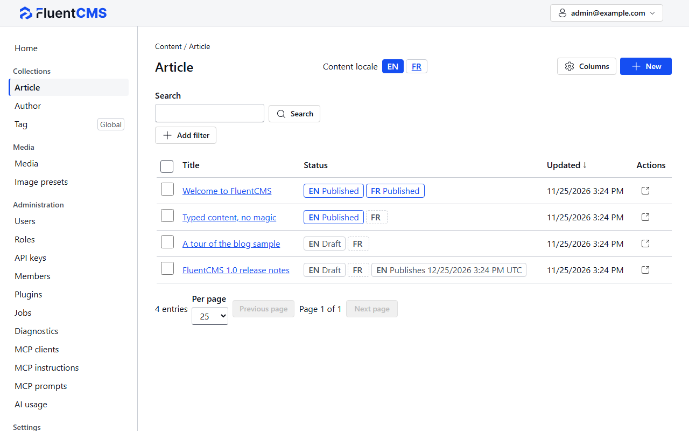

<p align="center">
  <picture>
    <source srcset="docs/resources/logo-dark.svg" media="(prefers-color-scheme: dark)">
    
  </picture>
</p>

<h3 align="center">FluentCMS</h3>
<p align="center">An open source headless CMS for .NET, with an admin for editors and an MCP server for AI agents.</p>

<p align="center">
  <a href="#documentation">Docs</a> ·
  <a href="#quick-start">Quick start</a> ·
  <a href="CHANGELOG.md">Releases</a> ·
  <a href="ROADMAP.md">Roadmap</a> ·
  <a href="https://discord.gg/WyqYuC6YbY">Discord</a>
</p>

<p align="center">
  <a href="https://www.nuget.org/packages/FluentCMS.Core"></a>
  <a href="https://github.com/fluentcms/FluentCMS/actions/workflows/ci.yml?query=branch%3Amain"></a>
  <a href="LICENSE"></a>
  <a href="https://discord.gg/WyqYuC6YbY"></a>
</p>

> **Preview.** FluentCMS is in preview: the public contract can still change between previews, and a preview makes no promise to upgrade a database. The latest release is `1.0.0-preview.2`, the first with the admin ([change log](CHANGELOG.md)).

## What is FluentCMS

FluentCMS is a headless CMS for .NET teams. It comes as NuGet packages that you add to an ASP.NET Core host, a reference host image for Docker, and a Blazor WebAssembly admin. Developers define the content model in C# and read content over REST or GraphQL, editors work in the admin, and AI agents work through an MCP server with the permissions of the user or key they sign in with.

<picture>
  <source srcset="docs/resources/admin-content-list-dark.png" media="(prefers-color-scheme: dark)">
  
</picture>

## Features

### For developers

- **Code-first schema.** Content types are C# classes, with content migrations and generated C# and TypeScript types for a front end.
- **REST and GraphQL.** A Delivery API for public reads and a Management API for the rest, with an OpenAPI document and GraphQL as a plugin.
- **Plugins as NuGet packages.** Media, webhooks, search and the other first-party features are plugins on the public SDK, and a plugin can add a half of its own to the admin.
- **Your database and your host.** SQLite, PostgreSQL or SQL Server, in a host made by `dotnet new fluentcms` or in the reference image.

### For content teams

- **An admin for editors.** Content lists, forms, a rich text editor, blocks and a media library, served at `/admin`.
- **Drafts and versions.** Save drafts, publish or schedule, compare and restore versions, and preview a draft in your front end.
- **Access control.** Roles with permissions down to fields and rows, two-factor sign-in and single sign-on.

### For AI agents

- **An MCP server.** Agents and IDEs connect to `/mcp`, or through `fluentcms mcp` over stdio, with tools for content and media.
- **Dry runs.** A delete, an unpublish or a bulk change answers its plan first, and runs only when it is called again with the plan's token.
- **AI assist in the editor.** Rewrite, shorten, summarize or write alt text with an OpenAI-compatible provider, with an optional daily token budget per site.

## Quick start

With the .NET 10 SDK, from nuget.org:

```bash
dotnet new install FluentCMS.Templates@1.0.0-preview.2
dotnet new fluentcms -n MyCms --sample blog
cd MyCms
dotnet run
```

The host runs on SQLite with the Blog sample, at `https://localhost:5443`. The [template's README](https://github.com/fluentcms/FluentCMS/blob/v1.0.0-preview.2/templates/fluentcms/README.md) of that release covers PostgreSQL and SQL Server, migrations, and [the first administrator and a key](https://github.com/fluentcms/FluentCMS/blob/v1.0.0-preview.2/templates/fluentcms/README.md#the-first-administrator-and-a-key). The host serves the admin at `https://localhost:5443/admin/`, with the development certificate trusted ([the first sign-in](docs/admin.md#the-first-sign-in)).

With Docker, the compose file of the reference host runs the published image on PostgreSQL, with its media in MinIO. In `src/FluentCMS.Host` of a clone of this repository, copy `.env.example` to `.env`, fill in every empty value, uncomment the two evaluation opt-ins, set `FLUENTCMS_IMAGE=ghcr.io/fluentcms/fluentcms:1.0.0-preview.2`, and start:

```bash
docker compose pull
docker compose up -d --no-build
```

`http://localhost:8080/health/ready` answers `Healthy` once the host is ready. [Run with Docker](docs/docker.md) covers the first administrator, the admin and what to change before production.

## Documentation

- [Host configuration](docs/host-configuration.md), [Run with Docker](docs/docker.md) and [Reverse proxy](docs/reverse-proxy.md)
- The admin: [overview](docs/admin.md), [configuration](docs/admin-configuration.md), [hosting](docs/admin-hosting.md), [writing an admin half](docs/admin-plugins.md) and [translating](docs/admin-translating.md)
- [Content migrations](docs/content-migrations.md), [system migrations](docs/system-migrations.md), [plugin migrations](docs/plugin-migrations.md) and [backups](docs/backups.md)
- [The `fluentcms` tool](src/FluentCMS.Cli/README.md), [the templates](templates/README.md) and [analyzer rules](docs/analyzers.md)
- Each package's README beside its project, under [`src`](src), [`src/plugins`](src/plugins) and [`admin/src`](admin/src), and the [TypeScript client](clients/typescript/README.md), `@fluentcms/client` on npm under the dist-tag `next`
- [Releasing and versioning](docs/releasing.md), the [backend technical specification](docs/planning/backend-technical-spec.md) and the [admin technical specification](docs/planning/admin-technical-spec.md)

## Community and support

- Ask questions on [Discord](https://discord.gg/WyqYuC6YbY).
- Report a bug or propose a feature in [GitHub issues](https://github.com/fluentcms/FluentCMS/issues/new/choose).
- Report a vulnerability privately, as the [security policy](SECURITY.md) says, never in a public issue.
- Read [CONTRIBUTING.md](CONTRIBUTING.md) to take part, and the [code of conduct](CODE_OF_CONDUCT.md).

## Earlier code and package names

Earlier work stays available, read-only and unmaintained, under `archive/*` branches and tags.

FluentCMS packages are published on nuget.org under the [FluentCMS profile](https://www.nuget.org/profiles/FluentCMS) with the `FluentCMS.*` prefix, and the package named just [`FluentCMS`](https://www.nuget.org/packages/FluentCMS) belongs to a different project.

## License

[MIT](LICENSE)
